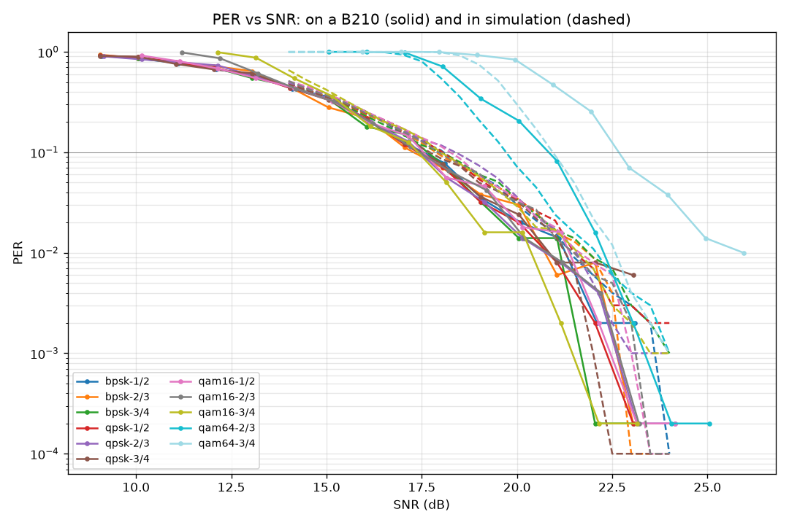
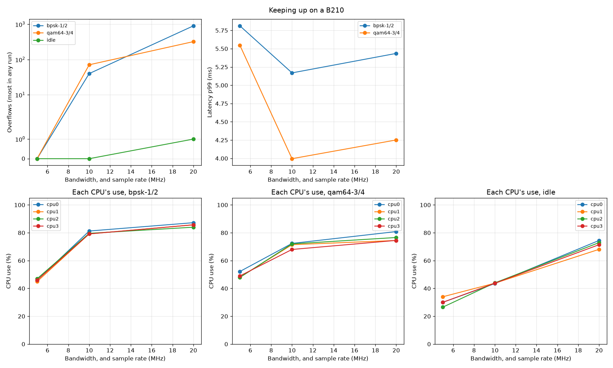
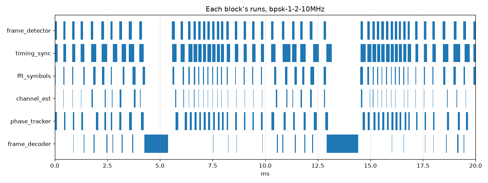
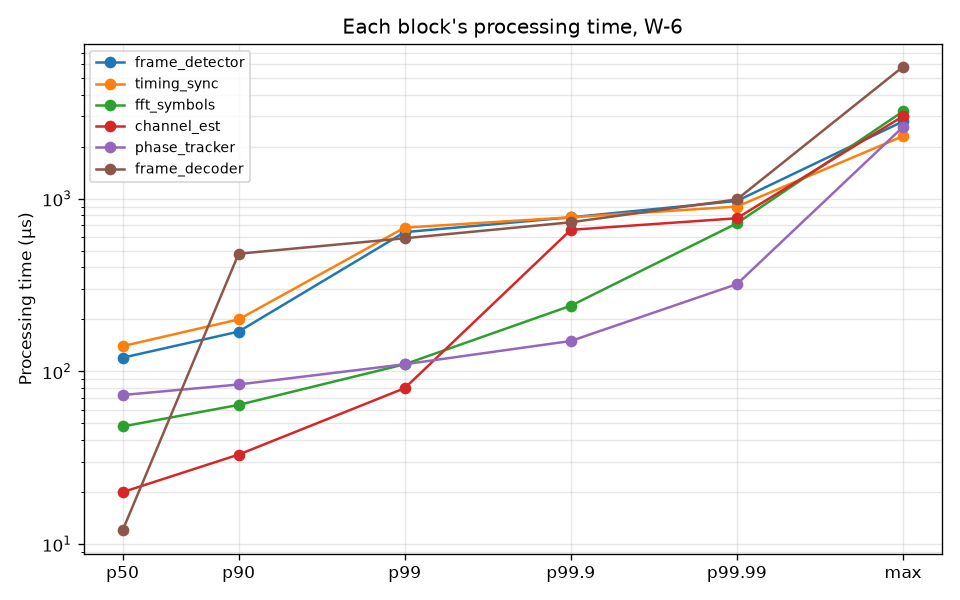
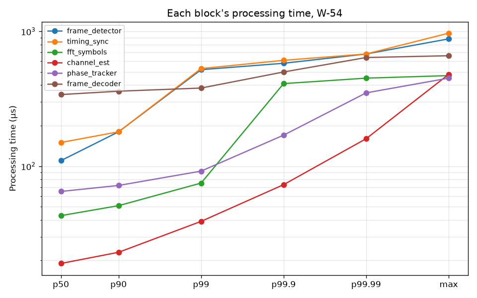

# v2.1.0 Measure

## Headline

On a Raspberry Pi 5, the receiver decodes 16.5 MS/s at BPSK 1/2 and 8.7 MS/s
at 64-QAM 3/4, against the 20 MS/s that 802.11a's 20 MHz channels need. Over
a cabled B210, it keeps up with 5 MHz channels at every rate, but not with
10 MHz ones, and every rate up to 16-QAM reaches 10% PER at 17.3 to 17.7 dB,
about 0.5 dB below simulation. This is the baseline the next milestones
improve on.

## What's new

- **aarch64.** Every release has an aarch64 archive beside the x86-64 one,
  and CI runs the tests on both. Each archive now has `fun-ofdm-bench` too.
- **A B210.** `fun-ofdm loopback` sends frames from one of a USRP's ports to
  another and checks every byte, and the B210 works in the dev container. The
  hardware tests (`uv run pytest hil`, [hil/README.md](../../../hil/README.md))
  send 1,000 frames at three rates over a cable.
- **Reproducible runs.** `--seed` repeats a run, `--json` writes its summary,
  and `--payload-size` sets the frames' size. `sim` has a channel model:
  `--snr`, `--cfo`, `--timing-offset` and `--delay-spread`.
- **Metrics.** The receiver times every block and frame in histograms, counts
  how each frame is lost, and reports both in `--json`. `--trace` records a
  [Perfetto](https://ui.perfetto.dev) trace. `--config=no_metrics` builds
  without them ([src/metrics](../../../src/metrics/README.md)).
- **An SNR estimate.** The receiver estimates each frame's SNR from its long
  training symbols, and `--json` reports its quartiles for each rate.
- **Measurement tools,** in Python, with [uv](https://docs.astral.sh/uv/):
  `fun-ofdm-bench` ([src/bench](../../../src/bench/README.md)) and `measure.py`
  for the receiver's speed, the PER sweep in simulation
  ([tools/per](../../../tools/per/README.md)) and its guardrail tests in CI,
  `hardware_sweep.py` for keeping up and PER on a B210
  ([tools/hardware](../../../tools/hardware/README.md)), and `scorecard.py` and
  `charts.py` ([tools/scorecard](../../../tools/scorecard/README.md)), which
  turn their results into the tables and charts below. Every result records what
  made it: the binaries' SHA-256, the tool and its options, the machine, and the
  USRP ([tools/results/result.py](../../../tools/results/result.py)).
- **Releases carry their measurements:** `results-v2.1.0.tar.gz`, attached
  to the release, has every result, the full scorecard and every chart, and
  [docs/releasing.md](../../releasing.md) is the procedure.

## Results

The first scorecard, so there's no earlier release to compare with. Each
repeated number is the median of 20 runs, with the interquartile range in
brackets.

| | v2.1.0 |
|---|---|
| Unit tests | 737, with 96.9% line coverage of `src/` |
| Throughput, no frames (W-idle) | 21.0 MS/s (20.9 to 21.1) |
| Throughput, BPSK 1/2 (W-6) | 16.5 MS/s (16.3 to 16.6) |
| Throughput, 64-QAM 3/4 (W-54) | 8.72 MS/s (8.69 to 8.76) |
| Latency in `sim`, W-6: p50, p99, max | 5.2, 7.9 and 11.3 ms |
| Latency in `sim`, W-54: p50, p99, max | 5.7, 7.8 and 9.3 ms |
| Kept up on a B210, with no overflows | 5 MHz at BPSK 1/2 and 64-QAM 3/4, and 10 MHz with no frames |
| SNR at 10% PER, simulation | 17.7 to 18.4 dB up to 16-QAM, 19.7 and 20.9 dB for 64-QAM 2/3 and 3/4 |
| SNR at 10% PER, B210 | 17.3 to 17.7 dB up to 16-QAM, 20.8 and 22.7 dB for 64-QAM 2/3 and 3/4 |
| Link smoke test | 1000, 1000 and 998 of 1000 frames at BPSK 1/2, 16-QAM 1/2 and 64-QAM 3/4 |

The numbers hold up. Measured again, 87 of the 89 repeated rows were the
same, with throughput within 0.5%. The histograms cost under 2% of
throughput, and a trace about 4 to 5% at W-idle and W-6, and nothing
measurable at W-54. For the same run, the histograms'
percentiles match the trace's to within 0.09%.

### PER

Each rate's implementation loss, its SNR at 10% PER on the B210 minus in
simulation, at 5 MHz with 500 frames of 1000 bytes a step. The loss is from
the unrounded SNRs, so it can differ by 0.1 dB from the columns'
difference:

| Rate | B210 | Simulation | Loss |
|---|---|---|---|
| bpsk-1/2 | 17.5 dB | 18.1 dB | −0.5 dB |
| bpsk-2/3 | 17.3 dB | 17.9 dB | −0.6 dB |
| bpsk-3/4 | 17.7 dB | 18.0 dB | −0.4 dB |
| qpsk-1/2 | 17.4 dB | 18.0 dB | −0.6 dB |
| qpsk-2/3 | 17.4 dB | 18.4 dB | −0.9 dB |
| qpsk-3/4 | 17.5 dB | 17.7 dB | −0.2 dB |
| qam16-1/2 | 17.5 dB | 18.3 dB | −0.7 dB |
| qam16-2/3 | 17.4 dB | 17.9 dB | −0.5 dB |
| qam16-3/4 | 17.4 dB | 18.0 dB | −0.6 dB |
| qam64-2/3 | 20.8 dB | 19.7 dB | +1.1 dB |
| qam64-3/4 | 22.7 dB | 20.9 dB | +1.7 dB |

Up to 16-QAM, every rate is limited by `timing_sync`, which misses the long
training symbols at low SNR (see its `\bug`s), so below about 18 dB they all
lose frames alike. They need about 0.5 dB less on the B210 than in simulation,
which the next milestone should explain: the SNR scale comes from the
receiver's own estimate. Only 64-QAM is limited by its decoding, and loses 1
to 2 dB on hardware.

### Keeping up

The receiver isn't out of CPU when it falls behind: at 10 MHz, every core is
68 to 83% busy. The blocks run in lockstep, one batch each per call, so when
`frame_decoder` decodes a whole frame, for 1 to 1.5 ms, every block waits for
it, and then a backlog follows:

### Where the time goes

Each block's processing time per call, at each percentile, at BPSK 1/2 and
64-QAM 3/4:

## How it was measured

On a Raspberry Pi 5 (Cortex-A76) running Ubuntu 26.04, in the dev container,
with a B210 on USB 3, cabled from its TX/RX port to its RX2 port through a
40 dB attenuator ([hil/README.md](../../../hil/README.md)). The dev container
can't set the CPU governor, so the Pi ran with its stock settings; the
benchmarks and latency ran on CPUs 1 to 3, leaving CPU 0 to the rest of the
system.

Throughput and each block's cost come from `fun-ofdm-bench`, and latency from
`fun-ofdm sim`, each run 20 times. The PER curves in simulation come from the
PER sweep, 1000 frames a step, with the settings
[tests/test_per.py](../../../tests/test_per.py) checks.
On the B210, the receiver ran 5 s at each bandwidth and workload, 3 times
each, and keeping up means no overflow in any run. For PER, it stepped the TX
gain 1 dB at a time, with 500 frames a step, and mapped the gain to SNR with
the receiver's own estimate.

The realtime sweep ran before it was narrowed to 802.11a's bandwidths, and
also covered 6, 7, 8, 12.5 and 15 MHz; the archive keeps those steps apart,
in `extra/`, and reports the 5, 10 and 20 MHz ones.

Every result records the SHA-256 of the binaries it ran, built on the Pi
from this release's `src/`. They also say "with uncommitted changes": they
were measured at the version bump before `MODULE.bazel.lock` was fully
updated, which changes nothing in `src/`.

## Known bugs

Each is flagged with `\bug` in the named header. New since v2.0.0:

- `timing_sync`'s LTS correlation is divided by the received power, so loud
  frames miss its threshold
  ([`timing_sync.h`](../../../src/phy/timing_sync.h)).
- `recv_delay`, the delay from a sample to the host, drifts with the
  USRP's clock against the host's, by up to tens of ms an hour
  ([`receiver.h`](../../../src/receiver.h)).

Still open from v2.0.0:

- The receiver chain only decodes reliably in batches of more than 160
  samples ([`frame_detector.h`](../../../src/phy/frame_detector.h),
  [`timing_sync.h`](../../../src/phy/timing_sync.h),
  [`receiver_chain.h`](../../../src/phy/receiver_chain.h)).
- The frequency offset estimate is always 0
  ([`timing_sync.h`](../../../src/phy/timing_sync.h)).
- The tail bits are scrambled ([`ppdu.h`](../../../src/phy/ppdu.h)).
- `fft` never frees its FFTW buffers and plans
  ([`fft.h`](../../../src/phy/fft.h)).
- The USRP wrapper processes stale samples after an overflow, misses
  underflows, ignores `--tx-amp` in `send_burst()`, and streams RX samples
  while only transmitting ([`usrp.h`](../../../src/usrp/usrp.h)).
- `rx` takes the frames of a restarted transmitter for duplicates
  ([`framing.h`](../../../src/framing.h)).
- `rx` prints and flushes a line for every packet on the thread that reads
  from the USRP ([`main.cpp`](../../../src/main.cpp)).

The PHY still
[differs from 802.11a](../../../src/phy/README.md#differences-from-80211a).

## Links

Each issue, and the pull request that closed it:

- aarch64 support: [#30](https://github.com/bmorgan5/fun_ofdm/issues/30), [#40](https://github.com/bmorgan5/fun_ofdm/pull/40)
- Python tools: [#31](https://github.com/bmorgan5/fun_ofdm/issues/31), [#41](https://github.com/bmorgan5/fun_ofdm/pull/41)
- Reproducible runs: [#32](https://github.com/bmorgan5/fun_ofdm/issues/32), [#42](https://github.com/bmorgan5/fun_ofdm/pull/42)
- Channel model: [#33](https://github.com/bmorgan5/fun_ofdm/issues/33), [#43](https://github.com/bmorgan5/fun_ofdm/pull/43)
- Benchmarks: [#34](https://github.com/bmorgan5/fun_ofdm/issues/34), [#44](https://github.com/bmorgan5/fun_ofdm/pull/44)
- Metrics: [#35](https://github.com/bmorgan5/fun_ofdm/issues/35), [#45](https://github.com/bmorgan5/fun_ofdm/pull/45)
- PER vs SNR: [#36](https://github.com/bmorgan5/fun_ofdm/issues/36), [#46](https://github.com/bmorgan5/fun_ofdm/pull/46)
- Scorecard: [#37](https://github.com/bmorgan5/fun_ofdm/issues/37), [#47](https://github.com/bmorgan5/fun_ofdm/pull/47)
- First hardware test: [#38](https://github.com/bmorgan5/fun_ofdm/issues/38), [#48](https://github.com/bmorgan5/fun_ofdm/pull/48)
- Release v2.1.0: [#39](https://github.com/bmorgan5/fun_ofdm/issues/39)

[Every commit between v2.0.0...v2.1.0](https://github.com/bmorgan5/fun_ofdm/compare/v2.0.0...v2.1.0)
