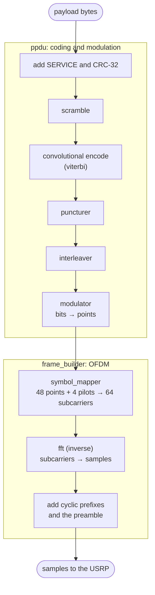
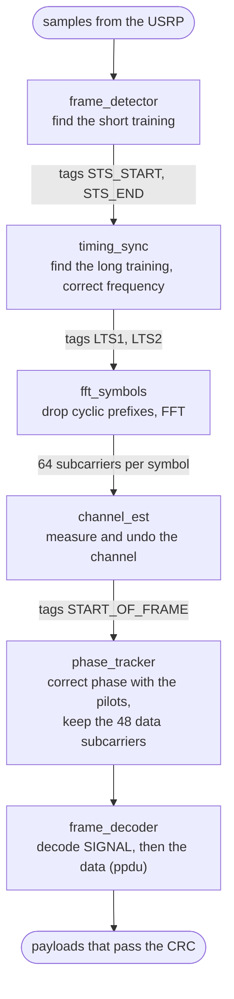

# The PHY

This directory is the 802.11a physical layer. It turns payload bytes into
complex baseband samples for the radio, and turns received samples back into
payloads. It's pure DSP, with no USRP dependency, so the tests and the `sim`
mode run it without hardware.

The explanation of each block, with diagrams, is in its header. This page is
the map: how a frame is laid out and how the blocks connect.

## OFDM in one page

OFDM (orthogonal frequency division multiplexing) splits the channel into 64
narrow subcarriers and sends one complex number, a *constellation point*, on
each of them at the same time. Each group of 64 points is one OFDM *symbol*.

- **Why:** a narrow subcarrier sees a flat channel, even when the whole channel
  doesn't. Echoes (multipath) make some frequencies fade and others not, and
  with OFDM that just means some subcarriers are weaker. The receiver corrects
  each subcarrier with one complex multiply, and the error correction code
  recovers the bits from the weak ones.
- **How:** an inverse FFT turns the 64 points into 64 time samples, which are
  the sum of 64 tones. The receiver's FFT turns them back into points.
- **Subcarriers:** 48 carry data and 4 carry known *pilots*, used to track phase
  drift. The other 12 are empty: the centre one (DC), where radios have a spike,
  and the edges, which keep the signal inside its channel.
- **Cyclic prefix:** each symbol's last 16 samples are copied in front of it,
  making 80 samples. Echoes of the previous symbol die out inside this copy, so
  they don't corrupt the 64 samples the receiver actually uses.

The sample rate is the channel bandwidth, which `fun-ofdm` sets to 5 MHz.
802.11a's standard 20 MHz gives 312.5 kHz subcarriers and 4 µs symbols; at
5 MHz everything takes four times as long.

## A frame: the PPDU

A frame is a PPDU (PLCP protocol data unit, 802.11a-1999 section 17.3.2):
everything the PHY sends for one packet from the layer above.

On the air, it's a burst of complex baseband samples, in time order. Each sample
is one complex number, I + jQ, which the USRP turns into the radio signal around
the centre frequency, and there's one per cycle of the sample rate. This is
the standard's figure 110, in samples, with the times at 802.11a's 20 MHz (four
times as long at `fun-ofdm`'s 5 MHz):

```
 ┌───┬───┬───┬───┬───┬───┬───┬───┬───┬───┬─────┬──────┬──────┬────┬────────┬────┬────────┬─────
 │ t1│ t2│ t3│ t4│ t5│ t6│ t7│ t8│ t9│t10│ GI2 │  T1  │  T2  │ GI │ SIGNAL │ GI │ Data 1 │ ...
 └───┴───┴───┴───┴───┴───┴───┴───┴───┴───┴─────┴──────┴──────┴────┴────────┴────┴────────┴─────
 ◄─────────── 10 × 16 = 160 ────────────►◄ 32 + 2 × 64 = 160 ►◄─ 16 + 64 ──►◄─ 16 + 64 ──►
                   8 µs                          8 µs             4 µs          4 µs
  detect the                              exact timing,       RATE,         SERVICE
  frame                                   channel estimate    LENGTH        + DATA
 ◄───────── PLCP preamble: 12 symbols, 320 samples ─────────►
```

- **PLCP preamble** (`preamble.h`): the same 320 samples in every frame. t1 to
  t10 are ten copies of a 16-sample short training symbol. T1 and T2 are two
  copies of a 64-sample long training symbol, after a 32-sample guard
  interval, GI2.
- **SIGNAL and DATA symbols:** each is a 16-sample guard interval (GI), which
  is the cyclic prefix, then 64 samples from the inverse FFT of the symbol's
  64 subcarriers. 48 of those carry a constellation point each, and each point
  carries 1 to 6 coded bits, depending on the modulation.

Before coding, those symbols carry these bits. This is the standard's figure
107, with sizes in bits:

```
             ├─────────────────── PLCP header ────────────────────┤
             ┌──────┬──────────┬────────┬────────┬──────┬─────────┬────────────┬──────┬─────┐
             │ RATE │ Reserved │ LENGTH │ Parity │ Tail │ SERVICE │ PSDU       │ Tail │ Pad │
             │ 4    │ 1        │ 12     │ 1      │ 6    │ 16      │            │ 6    │     │
             └──────┴──────────┴────────┴────────┴──────┴─────────┴────────────┴──────┴─────┘
             ◄──────────── BPSK, rate 1/2 ─────────────►◄──────── RATE from SIGNAL ────────►
┌────────────┬──────────────────────────────────────────┬───────────────────────────────────┐
│ PLCP       │ SIGNAL                                   │ DATA                              │
│ preamble   │ 1 OFDM symbol                            │ N OFDM symbols                    │
│ 12 symbols │                                          │                                   │
└────────────┴──────────────────────────────────────────┴───────────────────────────────────┘
```

- **PLCP header:** RATE to SERVICE. The SIGNAL symbol carries RATE to the first
  Tail, always at rate 1/2 BPSK, the most robust rate, so the receiver can
  decode it before it knows anything else (`ppdu.h`). The receiver checks the
  parity and that RATE is valid.
- **DATA:** SERVICE (16 zero bits), the PSDU, Tail and Pad bits, coded as one
  stream at the rate in SIGNAL and then cut into symbols. The fields don't line
  up with symbol boundaries, and there's one CRC for the whole PSDU. Each
  symbol holds dbps data bits (see `rates.h`), and the Pad bits fill the last
  one.
- **PSDU:** in 802.11 this is the MAC's frame, which already ends in its own
  CRC-32 (the FCS), and LENGTH is its length. This code differs: the PHY adds
  the CRC-32 itself and checks it on receive, and LENGTH doesn't count it. See
  the differences below.
- **Tail:** 6 zero bits that return the encoder to its starting state (see
  `viterbi.h`). Here the DATA tail comes after the Pad bits, and is scrambled;
  see the differences below.

The sizes follow from LENGTH and the rate's data bits per symbol (`dbps`):

```
DATA bits  = SERVICE + PSDU                + Tail
           = 16      + 8 × (LENGTH + 4)    + 6
N          = ceil(DATA bits / dbps)
Pad bits   = N × dbps − DATA bits
samples    = preamble + SIGNAL + DATA
           = 320      + 80     + 80 × N
```

For example, a 100-byte payload at 3/4 16-QAM, where `dbps = 144`:

```
DATA bits  = 16 + 8 × (100 + 4) + 6   = 854
N          = ceil(854 / 144)          = 6
Pad bits   = 6 × 144 − 854            = 10
samples    = 320 + 80 + 80 × 6        = 880    44 µs at 20 MHz, 176 µs at 5 MHz
```

## Transmit

`frame_builder` builds a frame from a payload. `ppdu` does the coding and
modulation; the rest is OFDM.



The SIGNAL symbol skips the scrambler and puncturer: parity bit, encode,
interleave, BPSK.

## Receive

`receiver_chain` runs six blocks, each on its own thread. Every call to
`process_samples()` runs all six at once on what's in their input buffers, then
moves each block's output to the next block's input. A frame therefore moves one
block further on each call, and the blocks pass tags along with the samples to
mark where the frame and its parts start.



Decoding the data is the transmit coding in reverse: demodulate (to soft bits),
deinterleave, depuncture, Viterbi decode, descramble, check the CRC.

## Reading order

Follow the transmit chain; each block's test shows what it does and how its
inverse undoes it.

| Block | Header | Test |
|---|---|---|
| Test data (PRBS-15) | [test_util.h](test_util.h) | [test_util_test.cpp](test_util_test.cpp) |
| Parity bit | [parity.h](parity.h) | [parity_test.cpp](parity_test.cpp) |
| Scrambling | [scrambler.h](scrambler.h) | [scrambler_test.cpp](scrambler_test.cpp) |
| Convolutional code | [viterbi.h](viterbi.h) | [viterbi_test.cpp](viterbi_test.cpp) |
| Puncturing | [puncturer.h](puncturer.h) | [puncturer_test.cpp](puncturer_test.cpp) |
| Interleaving | [interleaver.h](interleaver.h) | [interleaver_test.cpp](interleaver_test.cpp) |
| Modulation | [modulator.h](modulator.h), [qam.h](qam.h) | [modulator_test.cpp](modulator_test.cpp) |
| Rates | [rates.h](rates.h) | |
| Subcarrier mapping | [symbol_mapper.h](symbol_mapper.h) | [symbol_mapper_test.cpp](symbol_mapper_test.cpp) |
| FFT | [fft.h](fft.h) | [fft_test.cpp](fft_test.cpp) |
| SIGNAL and data coding | [ppdu.h](ppdu.h) | [ppdu_test.cpp](ppdu_test.cpp) |
| Preamble | [preamble.h](preamble.h) | |
| Whole transmitter | [frame_builder.h](frame_builder.h) | [frame_builder_test.cpp](frame_builder_test.cpp) |
| Moving sum | [circular_accumulator.h](circular_accumulator.h) | [circular_accumulator_test.cpp](circular_accumulator_test.cpp) |
| Receiver | [receiver_chain.h](receiver_chain.h), [block.h](block.h), [tagged_vector.h](tagged_vector.h) | |
| Receiver blocks | [frame_detector.h](frame_detector.h), [timing_sync.h](timing_sync.h), [fft_symbols.h](fft_symbols.h), [channel_est.h](channel_est.h), [phase_tracker.h](phase_tracker.h), [frame_decoder.h](frame_decoder.h) | |

## Differences from 802.11a

The transmitter and receiver match each other, so links between two copies of
this code work, but some of the coding doesn't match the standard yet, so they
can't talk to other 802.11a devices:

- **Convolutional code:** the generator polynomials are time-reversed, and the
  two outputs are swapped.
- **Puncturing:** rate 3/4 keeps A0 B0 B1 B2 instead of A0 B0 A1 B2, and rate
  2/3 keeps A0 A1 B1 instead of A0 B0 A1.
- **Interleaver:** always uses the BPSK permutation on blocks of 48 bits, even
  for QPSK and QAM.
- **Scrambler:** starts from a fixed state of 93, steps once per byte rather
  than per bit, and only flips the lowest bit of each byte.
- **Tail bits (a bug):** come after the padding instead of before it, and are
  scrambled with the rest of the data instead of being set to zero after
  scrambling. So the encoder doesn't always end in state 0, though the Viterbi
  decoder assumes it does. In practice only the tail bits themselves decode
  wrong, so frames still get through.
- **Bit order:** bytes are sent most significant bit first, and the SIGNAL
  field's bits are in a different order. The standard sends LSB first.
- **Rates:** there are three extra rates, 2/3 BPSK, QPSK and QAM16, which
  802.11a doesn't have.
- **CRC and LENGTH:** the PHY adds a CRC-32 to every payload, checks it on
  receive, and drops frames that fail. In 802.11 that's the MAC's job: the
  CRC-32 is the MAC frame's FCS, already in the PSDU the PHY is given, LENGTH
  counts it, and the PHY passes frames up without checking it. Here LENGTH is
  the payload's length, without the CRC. **TODO:** move the CRC-32 into the
  layer above the PHY (the MAC, once there is one), so the PSDU and LENGTH
  match the standard.

Each header describes its own differences. The tests that check the
convolutional code and the puncturing against the standard are skipped, with
the reason.
